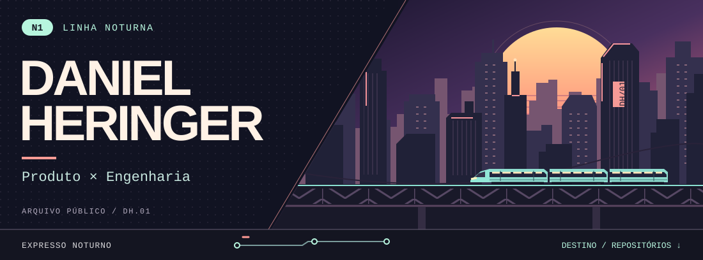

## Plataforma de embarque

Sou **Daniel Heringer**. Lidero o **4Pay na SEIDOR Brasil** e trabalho tanto com produto quanto com desenvolvimento full stack. Em três paradas, a linha vai do meu escritório de agentes até o terminal em Rust.

### N1 · Mapa da linha

| Estação | O que você encontra |
| :--- | :--- |
| **`01` 4hub** | Meu escritório virtual para acompanhar o trabalho dos agentes Codex. **Projeto privado.** |
| **`02` [headin_md](https://github.com/danielheringers/headin_md)** | As regras de engenharia que uso para orientar decisões de arquitetura, segurança, testes e entrega. **Skills · Markdown** |
| **`03` [codelicia](https://github.com/danielheringers/codelicia)** | Meu workspace derivado do Codex, com uma estratégia para acompanhar as mudanças do projeto original. **Rust · CLI** |

**Fim da linha?** [Explore os outros repositórios →](https://github.com/danielheringers?tab=repositories)
